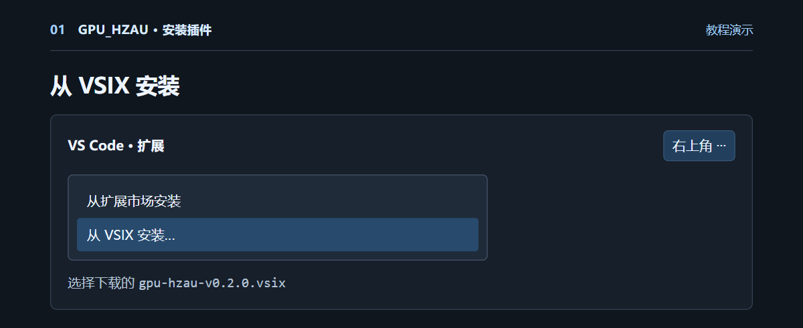
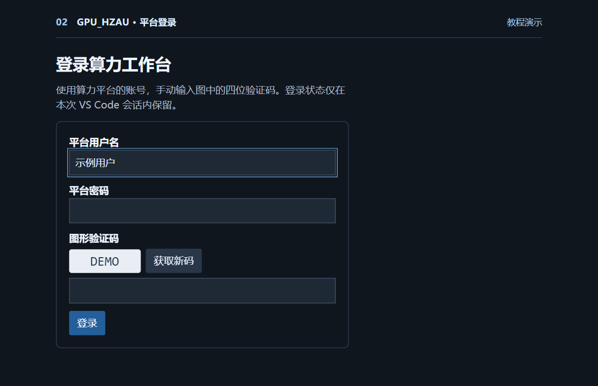
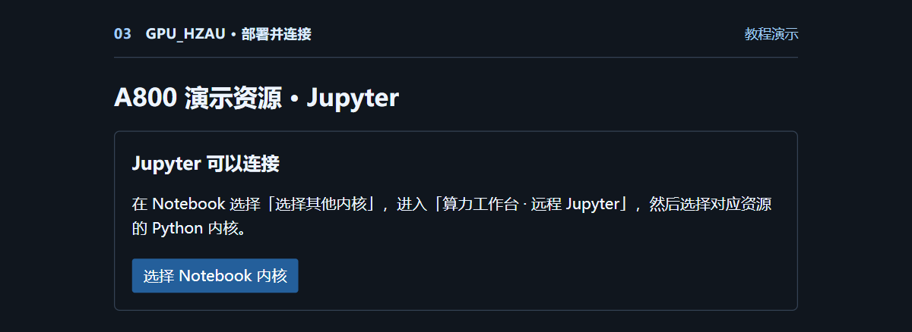
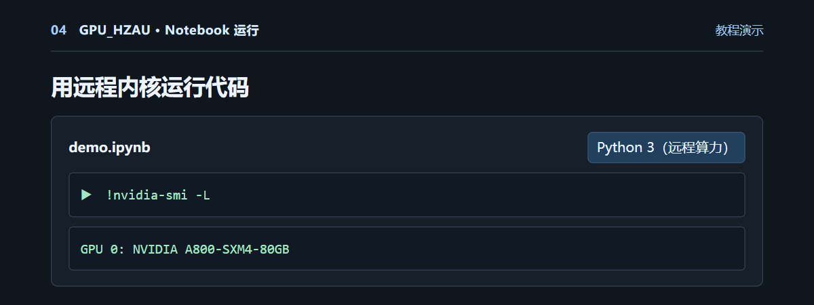
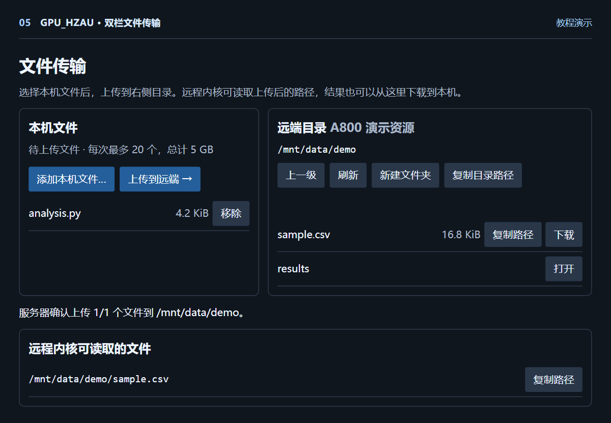

# GPU_HZAU · 算力工作台

在本机 VS Code 写 Notebook，用远程 A800 执行代码。插件可查看、启动和关闭开发环境，在本机与 `/mnt/data` 之间传文件，并查询平台账单。

**[下载 Windows 实测版 v0.2.0](https://github.com/peacezha/GPU_HZAU/raw/refs/heads/main/downloads/gpu-hzau-v0.2.0.vsix)** · [SHA-256 校验值](downloads/SHA256SUMS.txt) · [构建与测试](docs/development.md)

| 在哪儿 | 放什么 |
| --- | --- |
| 本机 VS Code | `.ipynb`、代码编辑、运行结果 |
| 远程 A800 | Python 内核和计算任务 |
| `/mnt/data` | A800 需要读取的数据、输出结果、Jupyter 离线包 |

## 1. 安装插件

使用桌面版 **Visual Studio Code 1.115.0 或更新版本**。下载 VSIX 后，打开「扩展」，点右上角 `…` →「从 VSIX 安装」，选择下载的文件。也可以在命令面板搜索 `Extensions: Install from VSIX`。



首次打开工作台时，插件会自动启动内置服务。安装会通过扩展市场获取微软 Jupyter 扩展。自动部署远程 Jupyter 时，插件会使用本机 Edge 或 Chrome。

## 2. 登录并启动 A800

点击活动栏的「算力工作台」，选择「登录算力平台」。填写已有的平台账号、密码和图片验证码。展开已有的 A800 开发环境。状态为「已停止」时，点击「启动资源」，等状态变成「运行中」。



## 3. 部署并连接远程 Notebook

1. 在运行中的资源下面点「部署并连接 Jupyter」。插件会检查 `/mnt/data`，复用已有的离线包或在缺少时上传，随后自动安装并测试内核。
2. 等状态显示「Jupyter 可以连接」。在 Notebook 右上角点「选择内核」。如果先看到「选择其他内核」，点进去。
3. 选择「算力工作台 · 远程 Jupyter」，再选对应资源的「Python 3（远程算力）」。



在 Notebook 的代码单元格运行以下命令。看到 `NVIDIA A800` 表示远程内核识别到了 GPU。

```python
!nvidia-smi -L
```



## 4. 让 A800 读取本机的数据

展开资源并点「浏览和传输文件」。左边选本机文件，右边进入目标目录，点「上传到远端」。上传完成后点「复制路径」。图中使用的是演示数据。



在 Notebook 中使用复制的远端路径。例如，把 `sample.csv` 上传至 `/mnt/data/demo` 后，可以读取前几行。

```python
from pathlib import Path

file = Path('/mnt/data/demo/sample.csv')
with file.open(encoding='utf-8') as stream:
    for _ in range(3):
        print(stream.readline().rstrip())
```

结果也可以写入 `/mnt/data`，再从右栏下载到本机。单次上传最多 20 个文件，总计 5 GB。遇到同名文件时，可改名或换目录。

## 5. 查看自动停止时间和账单

| 要做的事 | 入口 |
| --- | --- |
| 查看计划停止时间 | 展开资源，查看「自动停止」 |
| 提前结束本次使用 | 确认结果已保存后，点击「关闭资源」 |
| 查看用量和费用 | 点击「用量和费用」，读取平台已出账记录 |
| 配置 AI 助手 | 在工作台更多操作中选「设置 AI 模型」，填写兼容 Chat Completions 的地址、模型名和 Key，然后打开 AI 助手 |

## 常见问题

| 现象 | 处理方式 |
| --- | --- |
| 提示运行 `启动平台.cmd` | 在扩展列表确认安装的是本仓库的 v0.2.0。更新后重载 VS Code 窗口。 |
| 看不到远程内核 | 确认微软 Jupyter 扩展已安装，并等部署状态显示「Jupyter 可以连接」。再进入「选择其他内核」。 |
| 显示「部署尚未完成」 | 先确认资源仍在运行、网页开发环境能打开，再点「重试部署」。远端安装记录位于 `/home/work/.compute-connect/jupyter/setup.log`。 |
| 代码找不到 `D:\` 或 `C:\` 的数据 | 先把数据上传到 `/mnt/data`，再把代码里的路径换成复制的远端路径。 |
| Notebook 连接断开 | 刷新资源状态。如果实例已停止，重新启动后再次部署。关闭 VS Code 或会话到期后需要重新登录。 |

教程中的界面图使用示例账号和数据。v0.2.0 已在干净的 Windows VS Code 配置中验证安装、自动启动和获取真实验证码，远程内核转发通过本机 Jupyter 测试。真实 A800 的 Notebook 执行结果来自此前的端到端测试，v0.2.0 的真实 A800 部署仍待复测。
